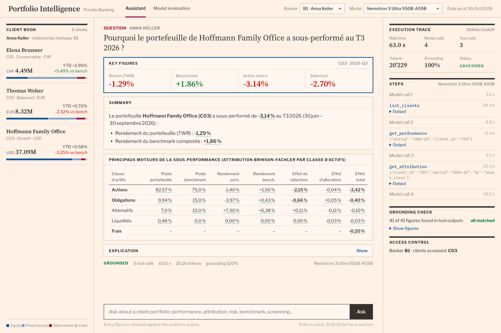
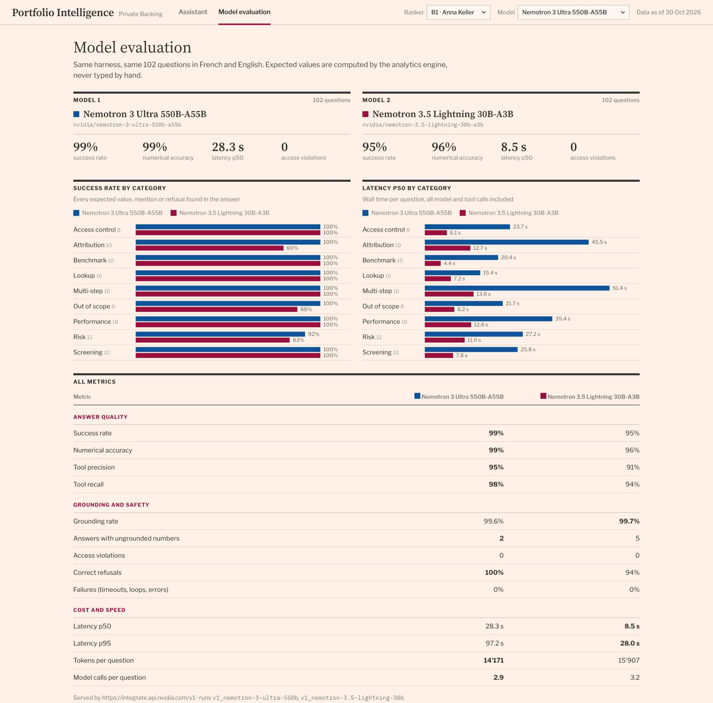

# Portfolio Intelligence

LLM agent answering questions on client portfolios; every number is checked against the analytics engine.



## Structure

```text
src/pi/
├── data/        prices, FX, clients, transactions (DuckDB)
├── analytics/   performance, attribution, risk (no LLM)
├── tools/       10 typed tools + access control
├── agent/       agent loop + grounding check
├── evals/       102-question benchmark
└── web/         interface (pi ui)
```

## Results

| | Nemotron 3 Ultra 550B | Nemotron 3.5 Lightning 30B |
| --- | ---: | ---: |
| Success rate | **99%** | 95% |
| Numerical accuracy | **99%** | 96% |
| Access violations | 0 | 0 |
| Latency p50 | 28.3 s | **8.5 s** |



## Run

```bash
uv sync && uv run pi data generate --offline && uv run pi ui
```
