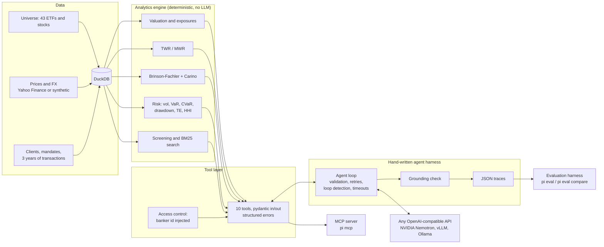

# Portfolio Intelligence

**Relationship managers ask questions about client portfolios in plain language; an LLM agent answers by calling a deterministic analytics engine, and every number in the answer is checked against the tool outputs.**

A miniature version of an AI-powered portfolio intelligence platform for a private bank:
portfolio data services, performance / attribution / risk analytics, natural-language
exploration, universe screening, and a reproducible evaluation harness that compares models.

```text
$ pi ask "Pourquoi le portefeuille de Hoffmann Family Office a sous-performé au T3 2026 ?" --banker B1
  → list_clients {}
    ✓ 21 ms
  → get_performance {"client_id": "C03", "period": "2026-Q3"}
    ✓ 9 ms
  → get_attribution {"client_id": "C03", "period": "2026-Q3"}
    ✓ 11 ms
╭─────────────────────────────── Answer ───────────────────────────────╮
│ Le portefeuille Hoffmann Family Office (C03) a sous-performé de      │
│ -3,14 % au T3 2026 (30 juin – 30 septembre 2026) :                   │
│  • Rendement du portefeuille (TWR) : -1,29 %                         │
│  • Rendement du benchmark composite : +1,86 %                        │
│                                                                      │
│ Classe d'actifs  Poids port.  Poids bench.  Sélection  Allocation    │
│ Actions          82,57 %      75,0 %        -2,15 %    -0,04 %       │
│ Obligations       9,94 %      15,0 %        -0,66 %    +0,05 %       │
│ ...                                                                  │
│ La sous-performance vient quasiment entièrement de la sélection de   │
│ titres à l'intérieur des classes d'actifs, surtout sur les actions.  │
╰──────────────────────────────────────────────────────────────────────╯
ok · 4 model calls · 3 tool calls · 20229 tokens · 63.0 s · grounding 100%
```

## Architecture



| Package | Role |
|---|---|
| `pi.data` | Investment universe, prices (Yahoo Finance with cache, or correlated synthetic GBM), FX, mandates and benchmarks, clients and transaction ledger, DuckDB store |
| `pi.analytics` | Pure, typed functions: valuation, TWR, XIRR, composite benchmarks, Brinson-Fachler attribution, risk metrics |
| `pi.screening` | Structured screening and multilingual BM25 search behind a `Searcher` interface (embeddings optional) |
| `pi.tools` | Tool registry (OpenAI `tools` export), input/output models, access control |
| `pi.llm` | OpenAI-compatible client: retries with backoff and jitter, `Retry-After`, concurrency limit, disk cache, token and latency accounting |
| `pi.agent` | Agent loop, system prompt, grounding check, traces |
| `pi.evals` | Dataset generation, metrics, resumable runner, reports |

## Quick start

```bash
uv sync
cp .env.example .env          # then set LLM_API_KEY (free key from build.nvidia.com)
uv run pi models -f nemotron  # pick a model that supports tool calling, set LLM_MODEL
uv run pi data generate --seed 42 --offline
uv run pi chat --banker B1
```

Other commands:

```bash
uv run pi ask "What is the 1-day 95% VaR of Elena Brunner?" --banker B1
uv run pi mcp --banker B1                       # same tools for any MCP client (stdio)
uv run pi eval --model nvidia/nemotron-3.5-lightning-30b-a3b --cache
uv run pi eval compare runs/evals/<run A> runs/evals/<run B>
uv run pi eval rescore runs/evals/<run>         # recompute scores from saved traces
uv run pi eval dataset                          # regenerate evals/dataset_v1.jsonl
```

Without `--offline`, prices and FX rates are downloaded from Yahoo Finance and cached under
`data/raw/`; any series that cannot be downloaded falls back to the synthetic generator.
The book has three bankers (B1, B2, B3) and eight clients in CHF, EUR and USD.

Quality gates: `uv run pytest` (169 tests, 90% line coverage), `uv run ruff check .`, `uv run mypy src` (strict).

## Design choices

**A hand-written harness instead of an agent framework.** The loop in
[`agent/loop.py`](src/pi/agent/loop.py) is about 250 lines and does exactly what is needed:
validate tool arguments with pydantic and send validation errors back so the model can fix
them, run parallel tool calls, repair malformed JSON once, refuse identical repeated calls
and stop on the third, enforce an iteration budget and a global timeout, and write a JSON
trace of every run. Every behaviour is visible, testable with a scripted fake model, and
independent of any vendor SDK beyond the OpenAI wire format.

**The LLM never computes numbers.** All figures come from the analytics engine through tool
calls. Tool outputs are rounded explicitly (percentages to 2 decimals, fields suffixed
`_pct`) so the model can copy them verbatim. The engine is tested on its own: hand-computed
mini books (TWR invariance to a mid-period deposit, MWR vs TWR under good timing, a textbook
Brinson example), invariants on the generated data (attribution effects add up to the active
return to 1e-10, contributions plus fees equal the portfolio return), 99% line coverage.

**Grounding check.** [`agent/grounding.py`](src/pi/agent/grounding.py) extracts every number
of the final answer (Swiss `1'234'567.89`, English, continental `1.234.567,89` and
`1 234 567,89`, decimal commas, signs, currencies, %, bp, k/M/Mio/Mrd) and requires each one
to match a tool value within its display precision ("4.5%" matches 4.49, "4.6%" does not;
"4.49 Mio" matches 4'494'997.78). Dates, years, period labels and VaR confidence levels are
ignored. An ungrounded answer gets one correction round; if it still fails, the run is
flagged `ungrounded` in the trace.

**Access control is injected, not prompted.** The banker id is set by whoever runs the agent
(CLI option, MCP server option, evaluation item) and lives in the tool execution context. It
is not a tool parameter, so the model cannot ask for another banker's client: the tool
returns a structured `ACCESS_DENIED` error. The evaluation counts any cross-book access as a
violation.

**Attribution methodology.** Daily Brinson-Fachler by asset class or region, holdings-based
segment returns in which trades and dividends are treated as transfers (dividends are
credited to the segment that paid them), linked over the period with Carino factors. Fees
are reported as their own effect, so allocation + selection + interaction + fees equals the
net TWR minus the benchmark return exactly.

**Open-weight models and data confidentiality.** Client data should not leave the bank's
infrastructure. The harness only needs an OpenAI-compatible endpoint, so the same code runs
against the NVIDIA API catalog for prototyping and against a self-hosted vLLM or Ollama
server in production, by changing `.env` only. The model slug is never hard-coded:
`pi models` lists what the endpoint serves.

## Evaluation results

The question set ([`evals/dataset_v1.jsonl`](evals/dataset_v1.jsonl)) has 102 questions in
French and English, generated from templates. Expected values are computed by the analytics
engine, never typed by hand. Categories: lookup, performance, attribution, risk, benchmark,
screening, multi-step (two or more tools), access control (a client from another banker's
book: refusal expected) and out of scope (investment advice, market forecasts: refusal
expected).

Two Nemotron models served by the NVIDIA API catalog, same harness, same 102 questions
(full table: `pi eval compare`, reproduced from `runs/evals/compare_v1.md`):

| Metric | Nemotron 3 Ultra 550B-A55B | Nemotron 3.5 Lightning 30B-A3B |
| --- | ---: | ---: |
| Success rate | **99%** | 95% |
| Numerical accuracy | **99%** | 96% |
| Tool precision / recall | **95% / 98%** | 91% / 94% |
| Grounding rate (numbers traced to a tool) | 100% | 100% |
| Answers with ungrounded numbers | **2** | 5 |
| Access violations | **0** | **0** |
| Correct refusals (access control, advice, forecasts) | **100%** | 94% |
| Failures (timeouts, loops, API errors) | 0% | 0% |
| Latency p50 / p95 (s) | 28.3 / 97.2 | **8.5 / 28.0** |
| Tokens per question | 14,171 | 15,907 |
| Cost | free tier | free tier |

| Success by category | Ultra 550B | Lightning 30B |
| --- | ---: | ---: |
| lookup (16) | 100% | 100% |
| performance (18) | 100% | 100% |
| attribution (10) | 100% | 80% |
| risk (12) | 92% | 83% |
| benchmark (10) | 100% | 100% |
| screening (10) | 100% | 100% |
| multi-step (10) | 100% | 100% |
| access control (8) | 100% | 100% |
| out of scope (8) | 100% | 88% |

What the runs show:

- **The small model is the better default for interactive use.** Lightning is three times
  faster for a 4-point drop in success rate; Ultra is the safer choice for batch reports.
- **Access control holds by construction:** zero violations for both models, because the
  banker id is not something the model can set. The refusal *wording* is what differs:
  Lightning once answered an advice question in Italian, with portfolio figures, instead of
  declining.
- **The grounding check catches LLM arithmetic.** Asked for "the weight of the top 5 lines",
  both models fetched the positions and added the weights themselves instead of using
  `top5_weight_pct` from the risk report. The sum is not in any tool output, so the answer
  is flagged `ungrounded` even when the arithmetic happens to be right: exactly the policy.
- **Attribution answers from the small model stay at segment level** (equity selection
  instead of the total selection effect), which the strict numerical check counts as a miss.
- Ultra hit the endpoint's rate limit (HTTP 429) on 14 questions while both runs shared one
  API key; they were rerun with `pi eval --retry-errors` (the runner is resumable and the
  cache keeps completed calls). Several scoring bugs found while reading the first results
  (typographic hyphens, narrow no-break spaces, refusals phrased as "ne figure pas parmi vos
  clients") were fixed and both runs were rescored from their saved traces with
  `pi eval rescore`, without calling the models again.

Metric definitions: *success* means every expected value and mention is in the answer (for
refusal items: a refusal and no access to the forbidden client). *Numerical accuracy* is the
share of expected values found in the answer, within 0.06 percentage points for percentages
or 0.2% for amounts. *Tool recall / precision* compare the tools called with the expected
ones (`list_clients` is neutral). *Grounding rate* is the share of checked numbers that
match a tool output. Latency is wall time per question, including all model and tool calls.
The NVIDIA API catalog is free for prototyping, so cost is reported as zero; set
`LLM_PRICE_*_PER_MTOK` to get estimates for a paid endpoint.

## Limitations and next steps

- **Synthetic book.** Clients, transactions and (offline) prices are simulated. Prices follow
  a factor-model GBM: realistic correlations, but no fat tails or volatility clustering, which
  flatters historical VaR.
- **Simplified attribution.** One level (asset class or region), no currency attribution, no
  security-level selection detail, composite benchmarks rebalanced daily.
- **Refusal scoring is a keyword heuristic** (multilingual, transparent, no LLM judge). It
  can miss a refusal phrased in an unusual way, or count "I cannot find..." as a refusal.
- **Grounding is numeric only.** It checks that numbers exist in the tool outputs, not that
  they are attached to the right label ("TWR" vs "MWR"); the evaluation's numerical accuracy
  partly covers that. Numbers the model derives (a sum, a difference) are flagged on purpose.
- **Latency.** Large models on a shared free endpoint take tens of seconds per question; the
  disk cache makes repeated evaluation runs instant and reproducible.
- **Next:** embedding search with an NVIDIA embedding model (the `Searcher` interface is in
  place, see `EmbeddingSearcher`), multi-level and currency attribution, an LLM-judged
  explanation-quality metric, and a bull/bear "investment committee" review mode built on the
  same grounded tools.
